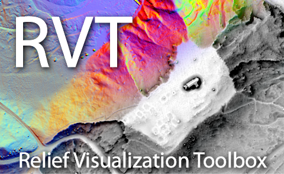

[](https://pypi.org/project/rvt-py/)
[](https://anaconda.org/channels/rvtpy/packages/rvt_py/overview)
[](https://anaconda.org/rvtpy/rvt_py)

# Relief Visualization Toolbox Python library



Relief Visualization Toolbox (RVT) was produced to help scientists visualize raster elevation model datasets. We have narrowed down the selection to include techniques that have proven to be effective for identification of small scale features. The default settings therefore assume working with high resolution digital elevation models derived from airborne laser scanning missions (lidar), however RVT methods can also be used for other purposes.

Sky-view factor, for example, can be efficiently used in numerous studies where digital elevation model visualizations and automatic feature extraction techniques are indispensable, e.g. in geography, archaeology,  geomorphology, cartography, hydrology, glaciology, forestry and disaster management. It can even be used in engineering applications, such as predicting the availability of the GPS signal in urban areas.

Methods currently implemented are:

* hillshading,
* hillshading from multiple directions,
* slope gradient,
* simple local relief model,
* multi-scale relief model,
* sky illumination,
* sky-view factor (as developed by our team),
* anisotropic sky-view factor,
* positive and negative openness,
* local dominance,
* multi-scale topographic position,
* visualization for archaeological topography (VAT),
* combined visualization for archaeological topography (Combined VAT).
* multi-scale topographic position enhanced version 4 (e^4^MSTP).

## RVT for Python

Version 3 is a rewrite of the library: a typed API with rasterio-based raster I/O, verified against the version 2 implementation with a golden-master test suite. The version 2 modules (`rvt.vis`, `rvt.blend`, `rvt.default`) have been replaced.

The ``rvt`` package is organised as:

* `rvt.visualization` — a config class per visualization, each with a `compute` method
* `rvt.blending` — layers, blend modes, normalization and the shipped blend presets
* `rvt.io` — reading and writing rasters
* `rvt.tiling` — tile-by-tile processing of DEMs too large for memory
* `rvt.Session` — batch computing and saving of visualizations for a DEM

### Computing a single visualization

Each visualization is a config object with a `compute` method over a DEM array (float32, NaN as nodata). `rvt.compute` applies one to a raster and keeps its georeferencing:

```python
import rvt
import rvt.io
from rvt.visualization import Hillshade, SkyViewFactor

dem = rvt.io.read("dem.tif")
hillshade = rvt.compute(Hillshade(sun_azimuth=315, sun_elevation=35), dem)
rvt.io.write(hillshade, "dem_hillshade.tif")

result = SkyViewFactor(include_positive_openness=True).compute(
    dem.array, dem.resolution
)
```

### Batch processing

`rvt.Session` computes and saves several visualizations for a DEM, with parameter-encoded file names:

```python
import rvt
from rvt.visualization import Hillshade, SimpleLocalReliefModel, SkyViewFactor

session = rvt.Session(
    dem_path="dem.tif",
    tasks=[
        rvt.SessionTask(Hillshade(), save_8bit=True),
        rvt.SessionTask(SimpleLocalReliefModel()),
        rvt.SessionTask(SkyViewFactor(include_positive_openness=True)),
    ],
)
written_paths = session.run()  # dem_HS_A315_H35.tif, dem_SLRM_R20.tif, ...
```

### Blending

Blends are layer stacks; the shipped presets (VAT, CRIM, e3MSTP, e4MSTP) are factory functions:

```python
import rvt.io
from rvt.blending import presets

dem = rvt.io.read("dem.tif")
vat = presets.vat()
image = vat.render(dem.array, dem.resolution)
```

## References

When using the tools, please cite the following:

*   Zakšek, K., Oštir, K., Kokalj, Ž. 2011. Sky-View Factor as a Relief Visualization Technique. Remote Sensing 3: 398-415.
*   Kokalj, Ž., Zakšek, K., Oštir, K. 2011. Application of Sky-View Factor for the Visualization of Historic Landscape Features in Lidar-Derived Relief Models. Antiquity 85, 327: 263-273.
*   Kokalj, Ž., Somrak, M. 2019. Why Not a Single Image? Combining Visualizations to Facilitate Fieldwork and On-Screen Mapping. Remote Sensing 11(7): 747.


## Installation

The RVT Python package can be installed using Conda or PyPI, and can be used in Python scripts, Jupyter Notebooks and ArcGIS Pro.

RVT can also be installed as [a set of custom raster functions for ArcGIS](https://rvt-py.readthedocs.io/en/latest/install_arcgis.html "ArcGIS installation"), and [a plugin for QGIS](https://rvt-py.readthedocs.io/en/latest/install_qgis.html "QGIS installation").

You can also clone the repository.

### Conda

The ``rvt`` package is [available from the Anaconda Cloud repository](https://anaconda.org/rvtpy/rvt_py "rvt_py on Anaconda Cloud"). Using Conda to install the ``rvt`` package will include all required libraries.

To use this method, first [install Anaconda and Conda](https://docs.conda.io/projects/conda/en/latest/user-guide/getting-started.html "Getting started with conda").

Then open Anaconda Prompt (Windows) or Terminal (MacOS) and run:

``conda install -c rvtpy rvt_py``

### PyPI

Another option is to install the ``rvt-py`` package and required libraries [using the Python Package Index (PyPI)](https://pypi.org/project/rvt-py "rvt-py on PyPI").

Open Command Prompt (Windows) or Terminal (MacOS) and run:

``pip install rvt-py``

### Requirements

Version 3 requires Python 3.12 and the following libraries (rasterio replaces the ``gdal`` dependency of earlier versions):

*   numpy
*   scipy
*   rasterio
*   matplotlib
*   affine

## Development

The project uses [uv](https://docs.astral.sh/uv/):

```bash
uv sync
uv run pytest -n auto
uv run ruff check .
uv run ruff format .
uv run pyrefly check
```

The test suite verifies the implementation against golden-master fixtures in `tests/golden/`, generated with the version 2 code; `tests/golden/manifest.json` records the exact parameters and provenance of every fixture.

## Documentation
Documentation of the package and its use is available at [Relief Visualization Toolbox in Python documentation](https://rvt-py.readthedocs.io/).

## Contributing
Pull requests are welcome. For major changes, please open an issue first to discuss what you would like to change. Please report any bugs and suggestions for improvements.

## Acknowledgment
Development of RVT Python scripts was part financed by the Slovenian Research Agency core funding No. P2-0406, and by research project No. J6-9395.

## License
This project is licensed under the terms of the [Apache License](LICENSE).

## About
RVT Python library by Žiga Kokalj, Žiga Maroh, Krištof Oštir, Klemen Zakšek and Nejc Čož, 2022.

It is developed in collaboration between ZRC SAZU and University of Ljubljana. 


