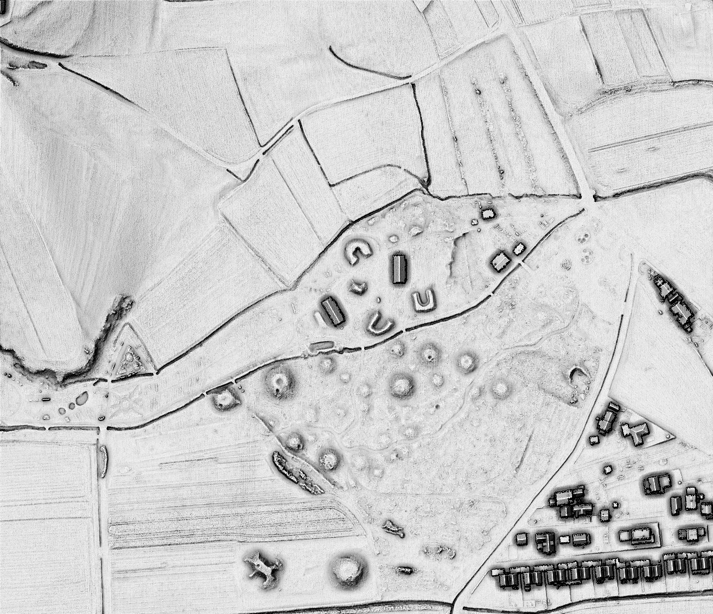
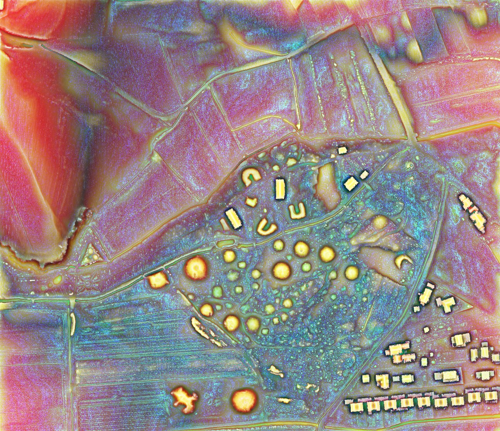
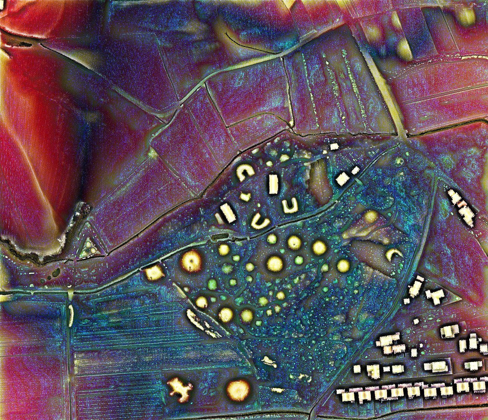

Blending
========

Single visualizations each show one aspect of the terrain. Blending fuses
several of them into one image, so that a single picture carries the
information of the whole stack. :mod:`rvt.blending` provides the layer model,
the blend modes, the color ramps and the shipped presets.

The layer model
---------------

A blend is a :class:`rvt.blending.BlendCombination`: a name and an ordered
tuple of :class:`rvt.blending.BlendLayer`. Layers are listed **top first** and
rendered **bottom-up** — the last layer is the base, and every layer above it is
blended over the result so far.

Each layer has four parts:

1.  a **source** — what image the layer contributes,
2.  a **normalization** — how that image is mapped onto the 0–1 range,
3.  a **blend mode** — how it combines with the layers below,
4.  an **opacity** in percent.

.. code-block:: python

   import rvt.io
   from rvt.blending import (
       BlendCombination,
       BlendLayer,
       BlendMode,
       Normalization,
       NormalizationMode,
       SkyViewFactorSource,
       VisualizationSource,
   )
   from rvt.visualization import Hillshade

   combination = BlendCombination(
       name="sky-view factor over hillshade",
       layers=(
           BlendLayer(
               source=SkyViewFactorSource(),
               normalization=Normalization(NormalizationMode.VALUE, 0.7, 1.0),
               blend_mode=BlendMode.MULTIPLY,
               opacity=50.0,
           ),
           BlendLayer(
               source=VisualizationSource(Hillshade()),
               normalization=Normalization(NormalizationMode.VALUE, 0.0, 1.0),
           ),
       ),
   )

   dem = rvt.io.read("dem.tif")
   image = combination.render(dem.array, dem.resolution)

``render`` returns the float image on the 0–1 range (single band, or a
bands-first RGB stack when a layer contributes color); ``render_8bit`` returns
the byte-scaled ``uint8`` version, with NaN encoded as 255 as in version 2.

.. autoclass:: rvt.blending.BlendCombination
   :members:
   :no-index:

.. autoclass:: rvt.blending.BlendLayer
   :members:
   :no-index:

Layer sources
`````````````

A source is anything that can produce a layer image from the DEM. Besides the
generic :class:`rvt.blending.VisualizationSource` (any config returning a bare
image) and :class:`rvt.blending.ImageSource` (a precomputed array), there are
named sources for the multi-output visualizations and for the composite images
the version 2 blender built internally.

Sources also carry ``inverts_normalization``, which reproduces the version 2
rule that slope gradient and negative openness are inverted while being
normalized (high values render dark). The defaults match version 2, so the
presets need no extra configuration.

.. autoclass:: rvt.blending.VisualizationSource
   :members:
   :no-index:

.. autoclass:: rvt.blending.ImageSource
   :members:
   :no-index:

.. autoclass:: rvt.blending.SlopeGradientSource
   :members:
   :no-index:

.. autoclass:: rvt.blending.SkyViewFactorSource
   :members:
   :no-index:

.. autoclass:: rvt.blending.PositiveOpennessSource
   :members:
   :no-index:

.. autoclass:: rvt.blending.NegativeOpennessSource
   :members:
   :no-index:

.. autoclass:: rvt.blending.OpennessDifferenceSource
   :members:
   :no-index:

.. autoclass:: rvt.blending.MultiDirectionalHillshadeRgbSource
   :members:
   :no-index:

.. autoclass:: rvt.blending.ColormappedSource
   :members:
   :no-index:

.. autoclass:: rvt.blending.BlendedSource
   :members:
   :no-index:

Normalization
`````````````

Normalization maps a visualization onto the 0–1 range before it is blended,
either between two absolute values or between two percentile cutoffs. Percentile
cutoffs are data-dependent: the same bounds give different results on different
DEMs (and on different tiles of one DEM), so prefer value mode for reproducible
output.

.. autoclass:: rvt.blending.Normalization
   :members:
   :no-index:

.. autoclass:: rvt.blending.NormalizationMode
   :members:
   :no-index:

Blend modes
```````````

.. autoclass:: rvt.blending.BlendMode
   :members:
   :no-index:

Color ramps
```````````

A single-band layer can be colored with any matplotlib colormap, optionally cut
to a sub-range, by wrapping its source in
:class:`rvt.blending.ColormappedSource` with a
:class:`rvt.blending.ColorRamp`.

.. autoclass:: rvt.blending.ColorRamp
   :members:
   :no-index:

Presets
-------

The shipped combinations are factory functions in
:mod:`rvt.blending.presets`. They return ordinary ``BlendCombination`` objects,
so they can be inspected, serialized, or used as a starting point for a
variation.

.. code-block:: python

   import rvt.io
   from rvt.blending import presets

   dem = rvt.io.read("dem.tif")
   image = presets.e4mstp(resolution=dem.resolution).render(dem.array, dem.resolution)

VAT
```



Visualisation for archaeological topography (VAT) is intuitive and easy to interpret, does not depend on the orientation or shape of small topographic features, ‘works well’ in all terrain types, and does not create artifacts. It is based on fusing four information layers into a single image (hillshade, slope, positive openness, and sky-view factor) (`Kokalj and Somrak 2019 <https://doi.org/10.3390/rs11070747>`_). VAT can enhance the visibility of features of varied scale, height, orientation, and form on terrain ranging from extremely flat to very steep.

Source:

*   Kokalj, Ž. in M. Somrak. 2019. `Why not a single image? Combining visualizations to facilitate fieldwork and on-Screen mapping <https://doi.org/10.3390/rs11070747>`_. Remote Sensing 11 (7): 747.
*   Kokalj, Ž. 2025. `Standardizing visualization in ancient Maya lidar research: Techniques, challenges and recommendations <https://doi.org/10.1002/arp.70002>`_. Archaeological Prospection 32(4): 967-988.

.. autofunction:: rvt.blending.presets.vat
   :no-index:

CRIM
````

The colored relief image map (CRIM) fuses the difference of positive and
negative openness over a colormapped slope base. It is used on its own and as
the color-carrying layer of e3MSTP.

.. autofunction:: rvt.blending.presets.crim
   :no-index:

e3MSTP
``````



Guyot et al. (2021) introduced the second version (e2MSTP), which fuses multi-scale topographic position (MSTP) with simple local relief model (SLRM) and red relief image map (RRIM). The latter is patented in some countries, and thus introduces uncertainty regarding patent status. To avoid infringement, the third enhanced version (e3MSTP), implemented in the RVT Python functions, replaces the RRIM with colored relief image map (CRIM) (Maroh 2021). The color combinations take time to become familiar with, but allow for better recognition of topographical features of various scales.

.. autofunction:: rvt.blending.presets.e3mstp
   :no-index:

e4MSTP
``````



Version 4 (e4MSTP) combines the red-toned slope with a combination of positive and negative openness and local dominance, merged sky view factors computed with two different radii and histogram stretches, and MSTP. This version is exceptional at showing small variations in topography in flat terrain, as well as at showing small structures. If colors are distracting, they can be removed by displaying (e4MSTP) with a luminosity blend mode (`Kokalj 2025 <https://doi.org/10.1002/arp.70002>`_).

Source:

*   Maroh, Ž. 2021. Methods for the Visualization of Digital Elevation Model with ArcGIS Pro Raster Functions. Master Thesis, University of Ljubljana: Ljubljana.
*   Kokalj, Ž. 2025. `Standardizing visualization in ancient Maya lidar research: Techniques, challenges and recommendations <https://doi.org/10.1002/arp.70002>`_. Archaeological Prospection 32(4): 967-988.

.. autofunction:: rvt.blending.presets.e4mstp
   :no-index:

JSON serialization
------------------

A combination can be written to and read back from JSON, schema
``rvt-blend/1``. Enums are serialized as their string values, and every layer
is a flat object: a ``source`` (a ``kind`` plus the visualization ``config``,
itself a ``type`` and its dataclass fields), a ``normalization``, a
``blend_mode`` and an ``opacity``.

.. code-block:: python

   from rvt.blending import combination_from_json, combination_to_json, presets

   text = combination_to_json(presets.vat())
   same_combination = combination_from_json(text)

The first layer of ``presets.vat()`` serializes as:

.. code-block:: json

   {
     "blend_mode": "multiply",
     "normalization": {
       "maximum": 1.0,
       "minimum": 0.7,
       "mode": "value"
     },
     "opacity": 25.0,
     "source": {
       "config": {
         "anisotropy_direction": 315.0,
         "anisotropy_level": 1,
         "directions": 16,
         "include_anisotropic": false,
         "include_positive_openness": false,
         "max_radius": 10,
         "noise_removal": "none",
         "type": "SkyViewFactor",
         "vertical_exaggeration": 1.0
       },
       "inverts_normalization": false,
       "kind": "sky_view_factor"
     }
   }

A layer built from :class:`rvt.blending.ImageSource` cannot be serialized (its
raw array is not JSON data) and raises ``ValueError``. There is **no reader for
the version 2 ``blender_*.json`` files**: the schema is new, and old blend
files have to be rebuilt in code.

.. autofunction:: rvt.blending.combination_to_json
   :no-index:

.. autofunction:: rvt.blending.combination_from_json
   :no-index:
