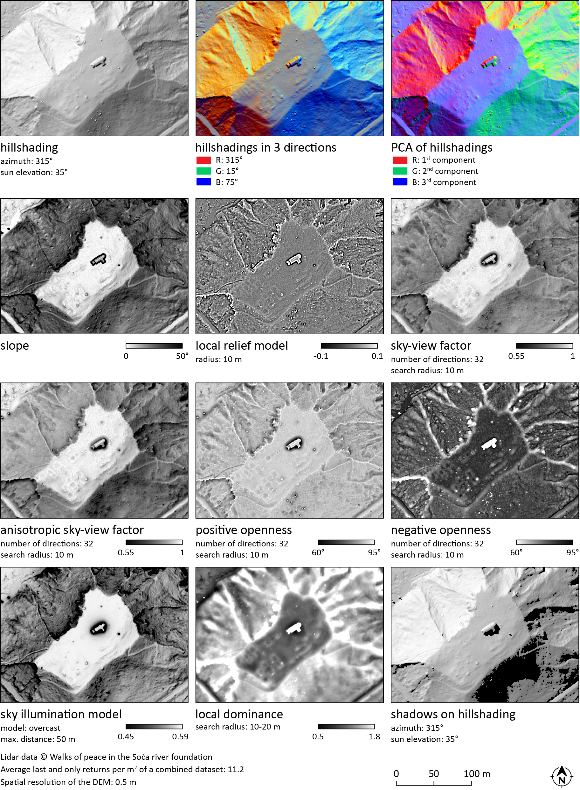
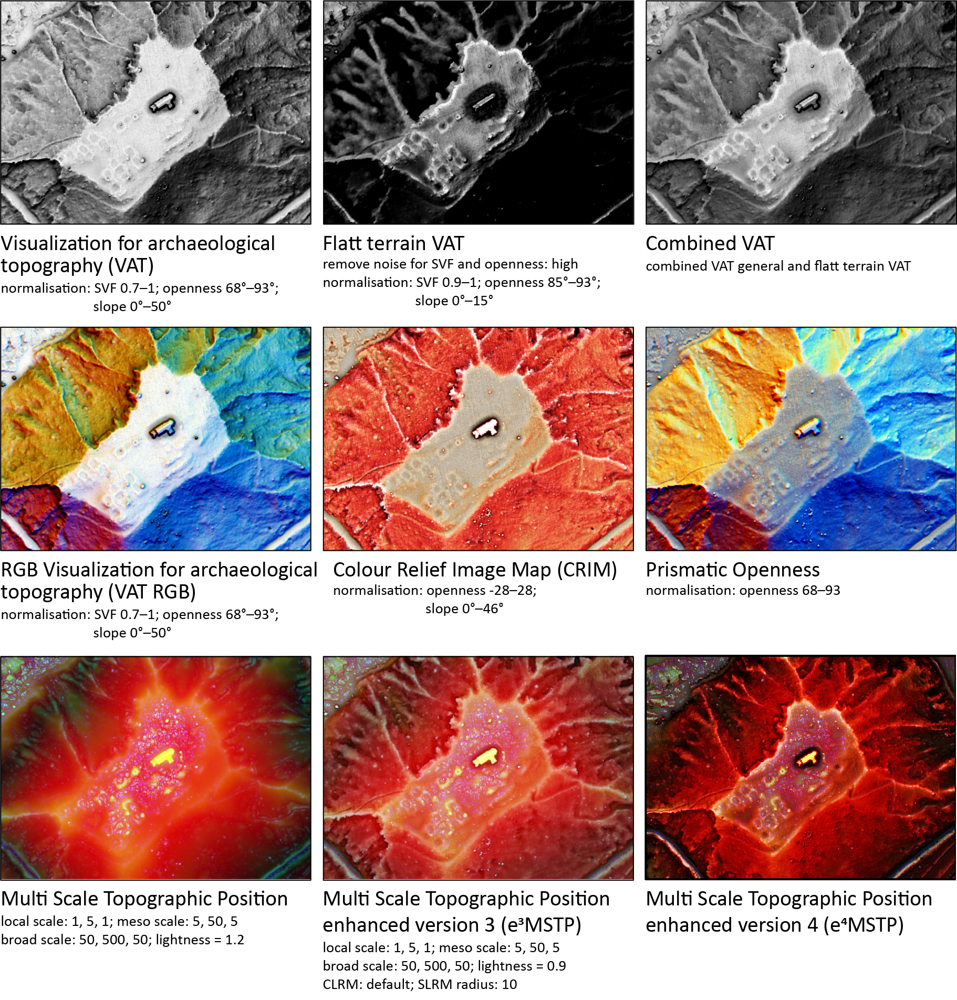

Relief Visualization Toolbox
============================

.. image:: ./figures/RVT_head.png
   :width: 700px

Relief Visualization Toolbox (RVT) was produced to help scientists visualize raster elevation model datasets. We have narrowed down the selection to include techniques that have proven to be effective for identification of small scale features. The default settings therefore assume working with high resolution digital elevation models derived from airborne laser scanning missions (lidar), however RVT methods can also be used for other purposes.

Sky-view factor, for example, can be efficiently used in numerous studies where digital elevation model visualizations and automatic feature extraction techniques are indispensable, e.g. in geography, archaeology,  geomorphology, cartography, hydrology, glaciology, forestry and disaster management. It can even be used in engineering applications, such as predicting the availability of the GPS signal in urban areas.

This documentation describes **version 3** of the Python library, a rewrite with a
typed API and rasterio-based raster I/O, verified against the version 2
implementation with a golden-master test suite. The version 2 modules
(``rvt.vis``, ``rvt.blend``, ``rvt.default``) have been replaced; see
:doc:`migration` if you have version 2 code.

RVT visualization methods
-------------------------

Methods currently implemented are (see also :doc:`visualizations`):

*   hillshading
*   hillshading from multiple directions
*   slope gradient
*   simple local relief model
*   multi-scale relief model
*   multi-scale topographic position
*   sky illumination
*   sky-view factor (as developed by our team)
*   anisotropic sky-view factor
*   local dominance
*   positive and negative openness
*   cast shadow and horizon
*   visualisation for archaeological topography (VAT)
*   colored relief image map (CRIM)
*   enhanced multi-scale topographic position version 3 (e3MSTP)
*   enhanced multi-scale topographic position version 4 (e4MSTP)



RVT visualisations



RVT combined visualisations

Package layout
--------------

The ``rvt`` package is organised as:

* :mod:`rvt.visualization` — a config class per visualization, each with a
  ``compute`` method
* :mod:`rvt.blending` — layers, blend modes, normalization and the shipped
  blend presets
* :mod:`rvt.io` — reading and writing rasters
* :mod:`rvt.tiling` — tile-by-tile processing of DEMs too large for memory
* :class:`rvt.Session` — batch computing and saving of visualizations for a DEM

Quick start
-----------

Computing a single visualization
````````````````````````````````

Each visualization is a config object with a ``compute`` method over a DEM
array (float32, NaN as nodata). :func:`rvt.compute` applies one to a raster and
keeps its georeferencing:

.. code-block:: python

   import rvt
   import rvt.io
   from rvt.visualization import Hillshade, SkyViewFactor

   dem = rvt.io.read("dem.tif")
   hillshade = rvt.compute(Hillshade(sun_azimuth=315, sun_elevation=35), dem)
   rvt.io.write(hillshade, "dem_hillshade.tif")

   result = SkyViewFactor(include_positive_openness=True).compute(
       dem.array, dem.resolution
   )

Batch processing
````````````````

:class:`rvt.Session` computes and saves several visualizations for a DEM, with
parameter-encoded file names:

.. code-block:: python

   import rvt
   from rvt.visualization import Hillshade, SimpleLocalReliefModel, SkyViewFactor

   session = rvt.Session(
       dem_path="dem.tif",
       tasks=[
           rvt.SessionTask(Hillshade(), save_8bit=True),
           rvt.SessionTask(SimpleLocalReliefModel()),
           rvt.SessionTask(SkyViewFactor(include_positive_openness=True)),
       ],
   )
   written_paths = session.run()  # dem_HS_A315_H35.tif, dem_SLRM_R20.tif, ...

Blending
````````

Blends are layer stacks; the shipped presets (VAT, CRIM, e3MSTP, e4MSTP) are
factory functions:

.. code-block:: python

   import rvt.io
   from rvt.blending import presets

   dem = rvt.io.read("dem.tif")
   vat = presets.vat()
   image = vat.render(dem.array, dem.resolution)

References
----------

When using the tools, please cite:

*   Zakšek, K., Oštir, K., Kokalj, Ž. 2011. `Sky-View Factor as a relief visualization technique <https://www.mdpi.com/2072-4292/3/2/398>`_. Remote Sensing 3: 398-415.
*   Kokalj, Ž. 2025. `Standardizing visualization in ancient Maya lidar research: Techniques, challenges and recommendations <https://doi.org/10.1002/arp.70002>`_. Archaeological Prospection 32(4): 967-988.


Further reading
---------------

*   Kokalj, Žiga, Ralf Hesse. 2017. `Airborne laser scanning raster data visualization: A Guide to Good Practice <https://omp.zrc-sazu.si/zalozba/catalog/book/824>`_. Ljubljana: Založba ZRC. (a comparative guide describing each method)
*   Kokalj, Ž., Somrak, M. 2019. `Why not a single image? Combining visualizations to facilitate fieldwork and on-screen mapping <https://www.mdpi.com/2072-4292/11/7/747>`_. Remote Sensing 11(7): 747. (explanation of blending techniques)

Contributing
------------

The project source code is available at `GitHub <https://github.com/EarthObservation/RVT_py>`_. Pull requests are welcome. For major changes, please open an issue first to discuss what you would like to change.

Please report any bugs and suggestions for improvements.

Acknowledgment
--------------

Development of RVT was part financed by the European Commission's Culture Programme through the ArchaeoLandscapes Europe project and by the Slovenian Research Agency core funding No. P2-0406, and by research projects No. J2-9251, No. J6-7085 and No. J6-9395.

Development of RVT QGIS plugin was part financed by PTS Consultancy via the UK Government Culture Recovery Fund.

About
-----

RVT Python library by Žiga Kokalj, Žiga Maroh, Krištof Oštir, Klemen Zakšek and Nejc Čož, 2022.

It is developed in collaboration between ZRC SAZU and University of Ljubljana.

License
-------

This project is licensed under the terms of the `Apache License <http://www.apache.org/licenses/LICENSE-2.0>`_.

© Copyright 2010-|year| ZRC SAZU and University of Ljubljana (UL FGG)

.. toctree::
   :hidden:

   installation
   visualizations
   blending
   large_rasters
   api
   migration
