Visualizations
==============

This section contains a list of the visualizations that RVT can produce with introductory descriptions.

Unless otherwise referenced, the descriptions are simplified versions of the information available in Kokalj, Žiga, Ralf Hesse. 2017. `Airborne laser scanning raster data visualization: A Guide to Good Practice <https://omp.zrc-sazu.si/zalozba/catalog/book/824>`_. Ljubljana: Založba ZRC.

Every visualization is a frozen config class in :mod:`rvt.visualization` with a
``compute(dem, resolution)`` method. The DEM is a 2D ``float32`` array with NaN
as nodata (:func:`rvt.io.read` produces exactly that), the resolution is a
:class:`rvt.core.Resolution`, and the result is a float array of the DEM's
shape — except the multi-band visualizations and the configs that return a
typed result object with several members. Use :func:`rvt.compute` to keep the
georeferencing of a raster, or :class:`rvt.Session` to compute and save several
visualizations at once.

Hillshading
-----------

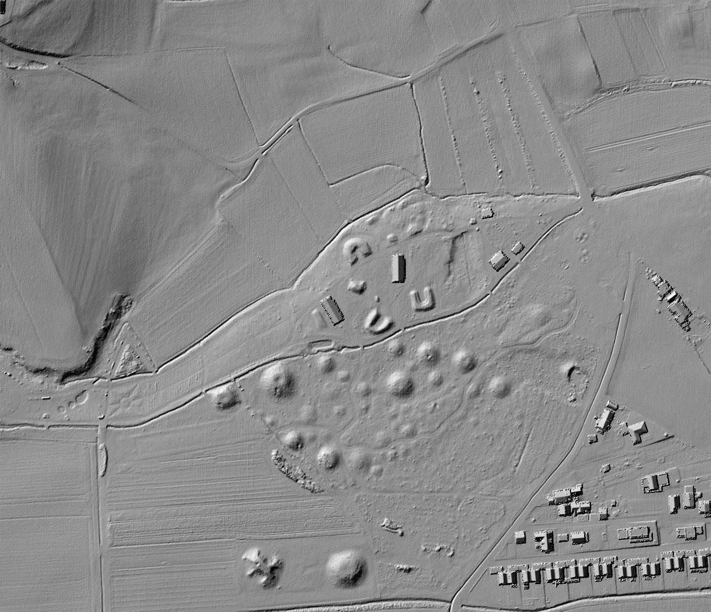

Hillshading (also known as relief shading or shaded relief) provides the most ‘natural’, i.e. intuitively readable, visual impression of all techniques.

It has a basic assumption that the relief is a Lambertian surface (equally bright from all viewing directions) illuminated by direct light from a fictive light source at an infinitive distance. The light beam has a constant azimuth and elevation angle for the entire area.

Applying several illumination directions can help to avoid the drawbacks of shaded relief, such as poor representation of linear features parallel to illumination azimuth, low contrast in areas facing towards (homogeneously bright) or away from (homogeneously dark) the light source, as well as optical illusions (e.g. inverted relief).

While very low illumination elevation angles (< 10°) can and should be used to highlight low relief features in areas of low slopes and flat terrain, higher illumination elevation angles (> 35°) are required in steeper topography.

To investigate features on moderate to steep slopes, shaded relief should be used with (almost) vertical illumination to minimize saturated bright/dark areas on slopes facing towards/away from the illumination. In such cases, shaded relief images become similar to slope images, which can be a useful alternative in moderate to steep topography.

.. autoclass:: rvt.visualization.Hillshade
   :members:
   :no-index:

Hillshading from multiple directions
````````````````````````````````````

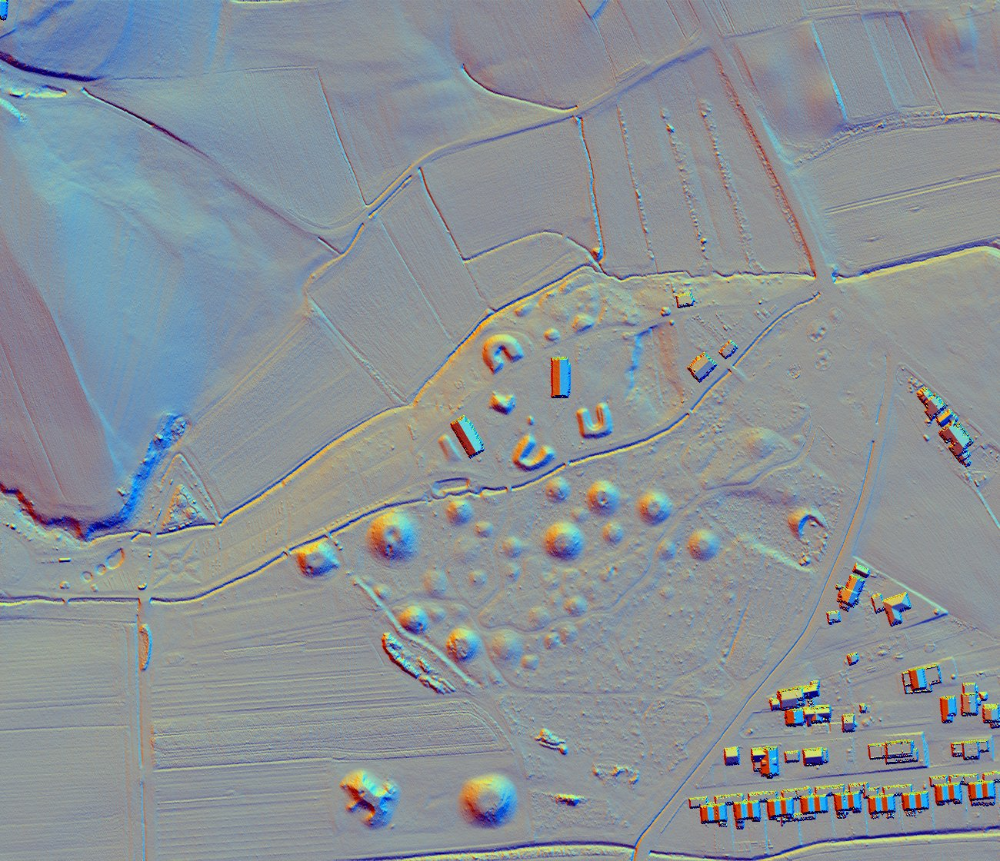

Producing multiple hillshading outputs by illuminating a surface from multiple directions enhances the visualization of topography.

Multi-directional hillshading reduces the need to compare multiple images, but the added complexity means they can be tricky to interpret. A step towards an improved understanding of the results is combining multiple shadings by considering only the mean, the maximum, or the range of values, for each pixel.

The 8-bit image is a result of calculation in three directions, separated by 67.5° (315° in the red band, 22.5° in the green band, 90° in the blue band).

The float result is a ``(directions, rows, columns)`` band stack, one hillshade
per azimuth. The three-band 8-bit rendering above is a blending construct, not
a stretch of that stack; it is available as
:class:`rvt.blending.MultiDirectionalHillshadeRgbSource`.

.. autoclass:: rvt.visualization.MultiHillshade
   :members:
   :no-index:

Slope
-----

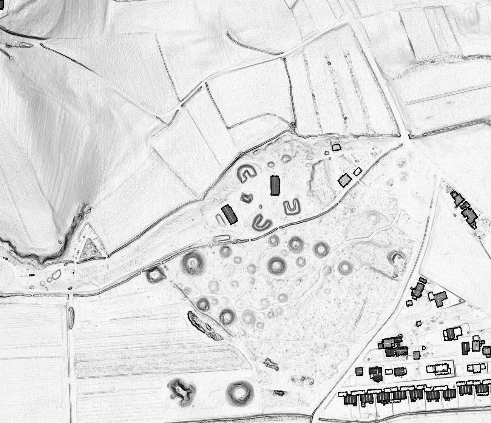

Slope (gradient) represents the maximum rate of change between each cell and its neighbours. It can be calculated either as percentage of slope or degree of slope. It is the first derivative of a DEM and is aspect independent.

Additional information is needed to distinguish between positive/convex (e.g. banks) and negative/concave (e.g. ditches) features, since slopes of the same gradient, regardless of rising or falling, are presented with the same colour.

.. autoclass:: rvt.visualization.SlopeAspect
   :members:
   :no-index:

.. autoclass:: rvt.visualization.SlopeAspectResult
   :members:
   :no-index:

.. autoclass:: rvt.visualization.SlopeUnits
   :members:
   :no-index:

Simple local relief model
-------------------------

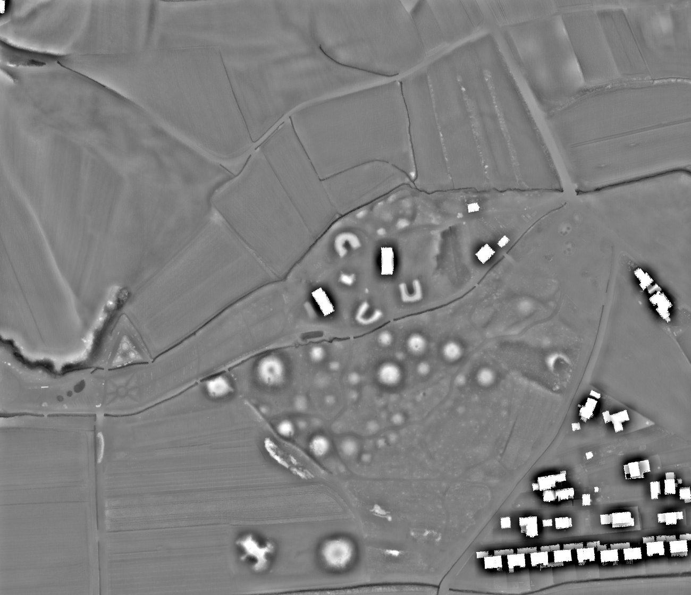

Simple local relief models use a procedure called trend removal that separates local small-scale features from large-scale landscape forms.

When working with a DEM, the trend (i.e. the larger landscape forms) is represented by a smoothed (generalized) version of that DEM. Trend removal is then accomplished by subtracting the smoothed DEM from the  original DEM. The resulting difference map contains only the local deviations from the overall landscape forms.

In areas with flat or very gentle to moderate topography, local relief model and local dominance are very helpful to highlight very low relief features such as former field boundaries or levelled burial mounds.

Local relief model and local dominance are interchangeable to a certain extent. Local relief model produces more realistic relative elevation values of relief anomalies. Local dominance retains a (limited) visual impression of the overall landscape forms as it produces higher values on slopes than on horizontal planes.

SLRM is computationally the same as the most common version of Topographic Position Index (TPI); the latter uses a small filter size, typically 3×3px2.

.. autoclass:: rvt.visualization.SimpleLocalReliefModel
   :members:
   :no-index:

Multi-scale relief model (MSRM)
-------------------------------

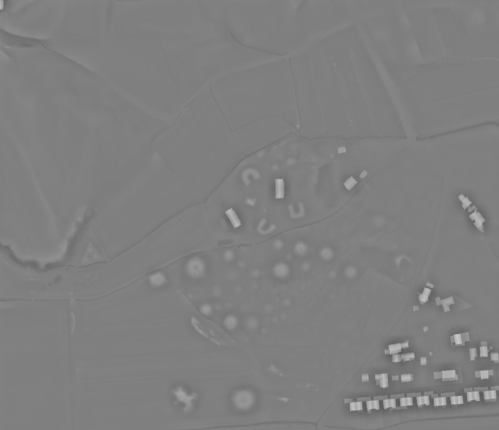

Multi-scale relief model (MSRM) was developed to extract micro-topographic information at various scales. Computing MSRM involves applying multiple low-pass (smooth) filters to the original DEM using a range of kernel radii. Ideally, these radii should span the full spectrum of sizes corresponding to potential features of interest. The algorithm then computes the differences between successive smoothed surfaces and derives the final multiscale relief by averaging these differential relief layers.

Source: Orengo, H. A., Petrie, C. A. 2018. `Multi-scale relief model (MSRM): a new algorithm for the visualization of subtle topographic change of variable size in digital elevation models <https://onlinelibrary.wiley.com/doi/full/10.1002/esp.4317>`_. Earth Surface Processes and Landforms, 43: 1361–1369.

.. autoclass:: rvt.visualization.MultiScaleReliefModel
   :members:
   :no-index:

Sky-view factor
---------------

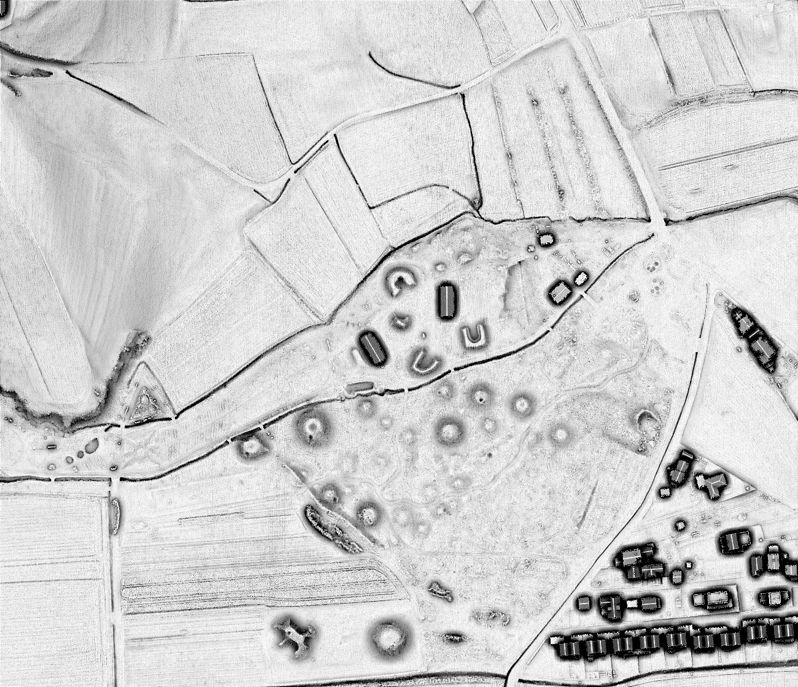

Sky-view factor (SVF) can be used as an alternative method of relief shading in order to overcome the directional problems of hillshading (see also: openness).

SVF represents the portion of the sky visible from a certain point. An imaginary light source illuminates the relief from the celestial hemisphere centred at the point being illuminated. It ignores any direction below the mathematical horizon (see also: openness). In contrast to shading techniques based on directional illumination, features visualized by SVF (or by openness) do not contain any horizontal displacements.

In areas of moderate to steep topography, sky-view factor works best to highlight surface depressions and features on slopes. Depending on the range of slopes in a given area under study, different histogram stretches may be necessary to avoid bright saturation in gentle topography and dark saturation on steep slopes.

In areas with flat or very gentle topography, sky-view factor is generally limited to the presentation of negative relief features (e.g. pits, ditches, quarries, erosion areas, dolines) and becomes very sensitive to DEM noise. A good general rule is to use a histogram stretch of 0.65 to 1.0 for diverse terrain and 0.9 to 1.0 for very flat terrain.

Sky-view factor, its anisotropic variant and positive openness share one
horizon search, so a single :class:`rvt.visualization.SkyViewFactor` config
computes all three much more cheaply than three separate runs. The members that
were not requested are ``None`` in the result.

.. autoclass:: rvt.visualization.SkyViewFactor
   :members:
   :no-index:

.. autoclass:: rvt.visualization.SkyViewFactorResult
   :members:
   :no-index:

.. autoclass:: rvt.visualization.NoiseRemoval
   :members:
   :no-index:

Anisotropic sky-view factor
```````````````````````````

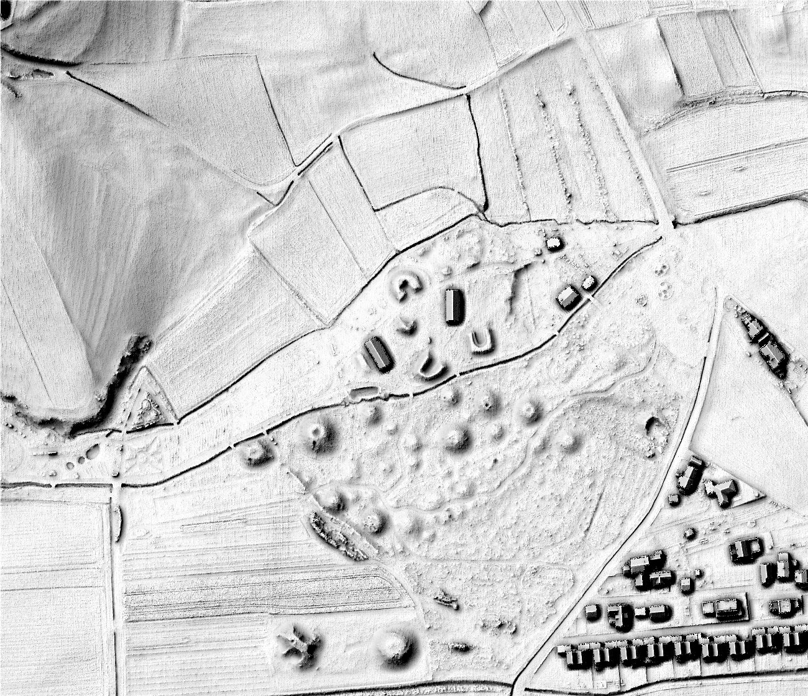

Anisotropic (directional) SVF assumes that the sky is brighter in some directions than in others. The brightness can depend on the azimuth and solar distance from the imaginary light source. This brings back some of the ‘plasticity’ of hill shading and gives better details on very flat areas.

Set ``include_anisotropic=True`` on the sky-view factor config to obtain it.

Openness
--------

Positive openness
`````````````````

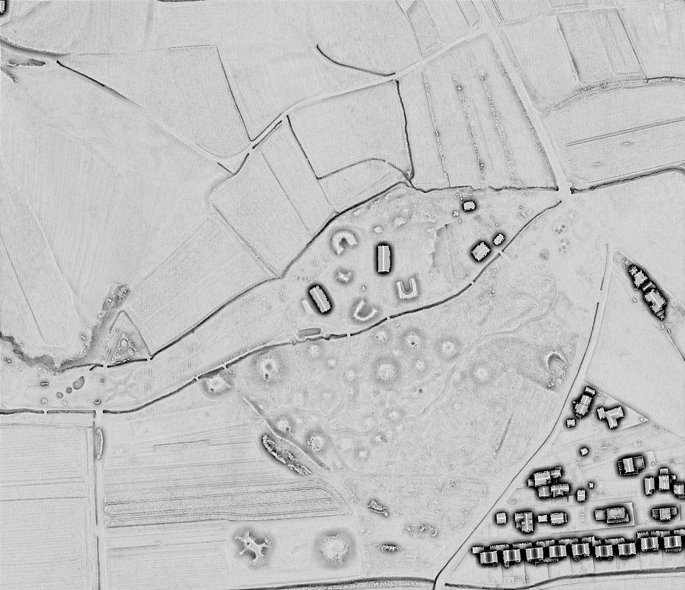

Openness is another proxy for relief shading (see also: sky-view factor). The method is based on estimating the mean horizon elevation angle within a defined search radius. The mean value of all zenith angles gives positive openness, while the mean nadir value gives negative openness.

Openness considers the whole sphere for calculation, not just the celestial hemisphere as SVF does. The result of this is a much ‘flatter’ image, devoid of general topography—a kind of trend-removed image. As the visual impression of the general topography is lost, interpretation becomes a bit trickier.

However, openness has big advantage for automatic feature detection because ‘signatures’ of features are more homogeneous because they are the same irrespectively of their location on a plane or slope.

Positive openness is a member of the sky-view factor result: set
``include_positive_openness=True`` on :class:`rvt.visualization.SkyViewFactor`.

Negative openness
`````````````````

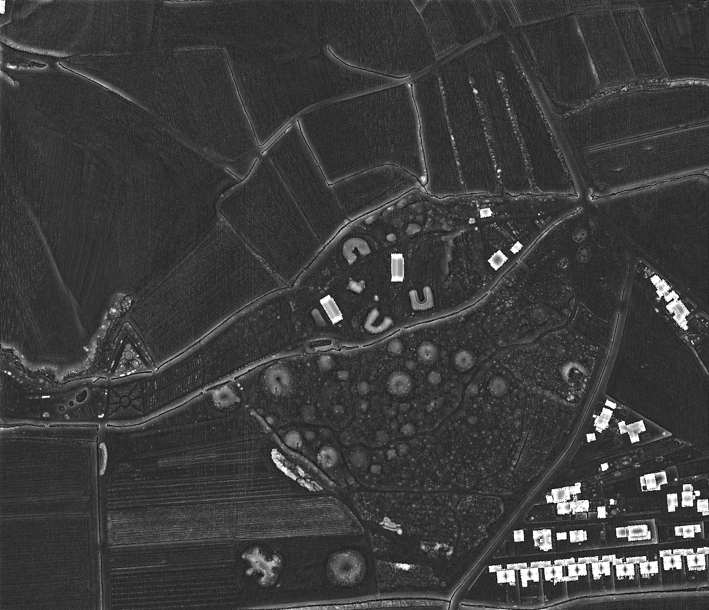

Negative openness is not the inverse of positive openness and it provides additional information. While positive openness highlights topographic convexities (e.g. ridges between hollow ways and rims of bomb craters), negative openness emphasizes the lowest parts of concavities, (e.g. the actual hollow ways, the lowest parts of gorges and the lower edges of cliffs).

For consistent readability, it is recommended that negative openness is displayed with inverted greyscale (i.e. darker for higher values), so that concave features are always presented by dark tones.

Positive and negative openness are very useful to highlight positive and negative relief features, respectively. As openness removes the visual impression of overall landscape forms, it is not affected by saturation due to gentle or steep slopes and may be used in a varied topography. Because of the ability to differentially highlight positive and negative relief features, it is particularly suitable for targeted detection of these features.

.. autoclass:: rvt.visualization.NegativeOpenness
   :members:
   :no-index:

Local dominance
---------------

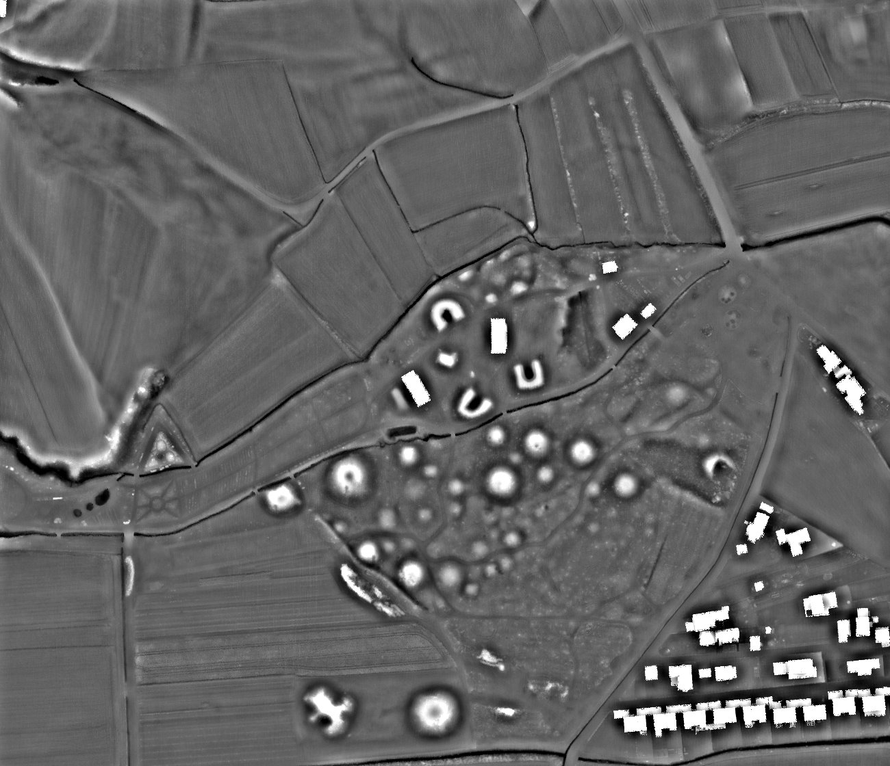

Local dominance is based on computing how dominant an observer standing on each pixel would be for a local surrounding area.

Dominance is the average steepness of the angle at which the observer looks down at the surrounding land surface. It is higher for points on local elevations as well as on slopes and lower for points in local depressions.

In areas with flat or very gentle to moderate topography, local dominance and local relief model are very helpful to highlight very low relief features such as former field boundaries or levelled burial mounds. Local dominanace also delivers very good results for topographic depressions such as dolines, mining traces, or hollow ways.

Local relief model and local dominance are interchangeable to a certain extent. Local relief model produces more realistic relative elevation values of relief anomalies. Local dominance retains a (limited) visual impression of the overall landscape forms as it produces higher values on slopes than on horizontal planes.

.. autoclass:: rvt.visualization.LocalDominance
   :members:
   :no-index:

Sky illumination
----------------

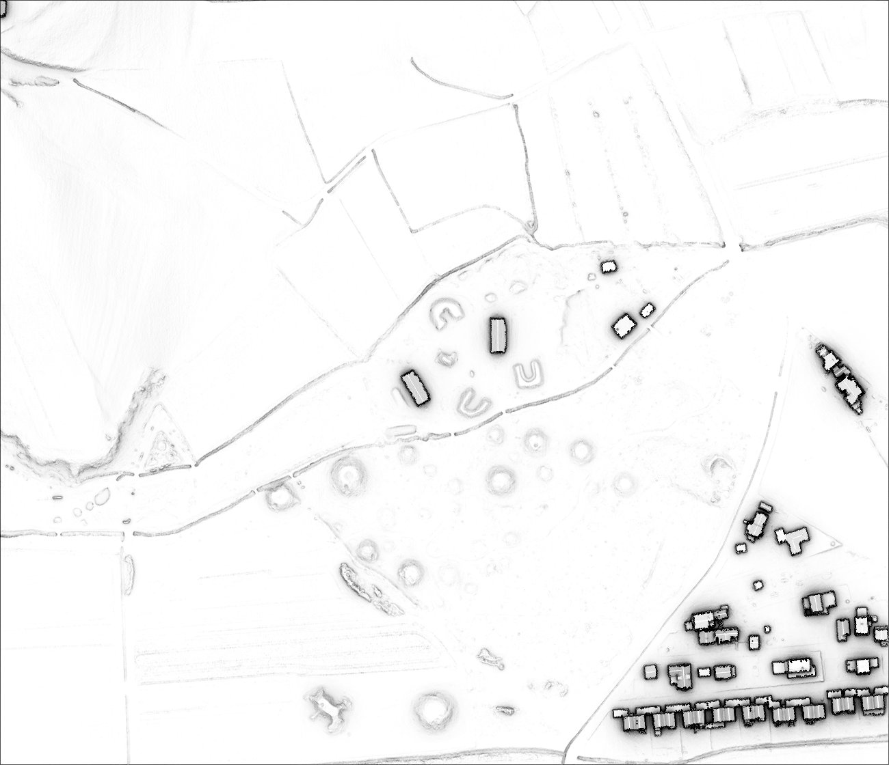

Sky illumination models quantitatively represent natural luminance of the sky under various atmospheric conditions.

Uniform and overcast sky models are implemented as they both disregard directional shadowing effects. Mode details in shadows can be seen using the overcast sky model.

Calculations last much longer than for other visualizations especially with large maximum shadow modelling distance.

Source: `Relief Visualization Toolbox ver. 2.2.1 Manual <https://www.zrc-sazu.si/sites/default/files/rvt_2.2.1_0.pdf>`_

.. autoclass:: rvt.visualization.SkyIllumination
   :members:
   :no-index:

.. autoclass:: rvt.visualization.SkyModel
   :members:
   :no-index:

Cast shadow and horizon
-----------------------

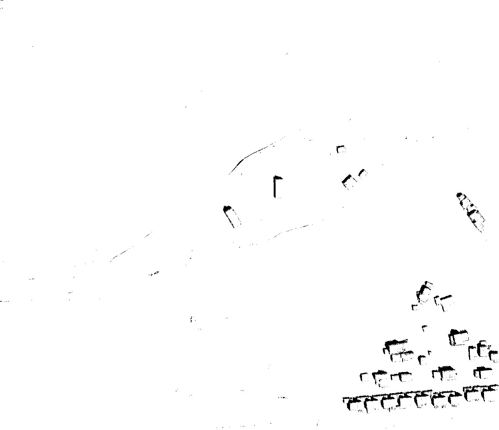

The shadow visualization models which parts of the terrain a light source at a
given azimuth and elevation reaches: the horizon elevation angle towards the
sun is searched for every pixel, and the pixel is lit when the sun stands above
it. Both the binary shadow mask and the horizon angle itself are returned; the
horizon angle is the intermediate product the sky illumination model uses as
well.

.. autoclass:: rvt.visualization.ShadowHorizon
   :members:
   :no-index:

.. autoclass:: rvt.visualization.ShadowHorizonResult
   :members:
   :no-index:

Multi-scale topographic position (MSTP)
---------------------------------------

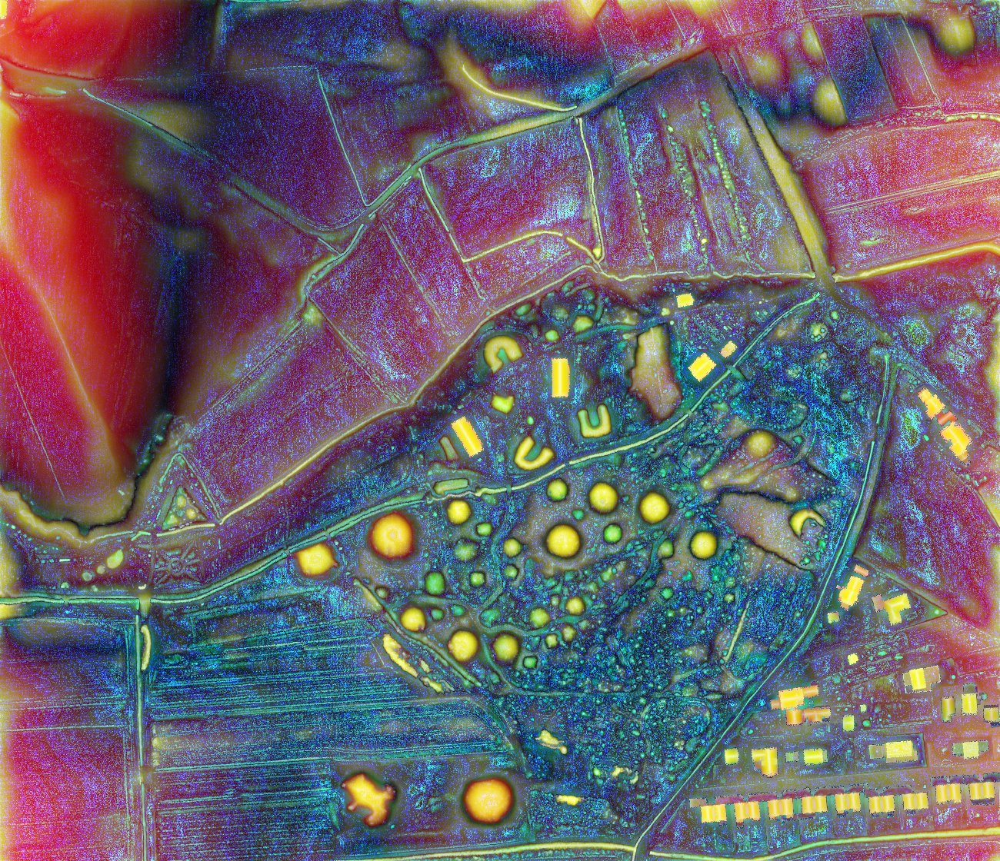

A multi-scale topographic position (MSTP) is generated from a hyperscale datacube of the topographic metric deviation from mean elevation (SLRM) computed with various search radius parameters and reduced to three dimensions by extracting the absolute maximum value from micro-, meso-, and macro-scale ranges, written as a three band (RGB) raster.

Some practice is required to train the eye to recognize colors as the summation of relative topographic position across three scale ranges, rather than, for example, as the raw elevation observed in a DEM. Colours do not have a unique meaning – the same color range can represent a slightly raised embankment or a very shallow dip. Therefore, additional information is needed to distinguish between concave and convex features.

Source: Lindsay, Cockburn, Russell 2015. `An integral image approach to performing multi-scale topographic position analysis <https://www.sciencedirect.com/science/article/pii/S0169555X15300076?via%3Dihub>`_.

.. autoclass:: rvt.visualization.MultiScaleTopographicPosition
   :members:
   :no-index:

Converting to 8-bit
-------------------

Every config carries the legacy 8-bit stretch of its visualization as the
``EIGHT_BIT_STRETCH`` class attribute, and :func:`rvt.stretch.to_8bit` applies
a :class:`rvt.stretch.Stretch` to a float result. :class:`rvt.Session` does
this for you when a task sets ``save_8bit=True``.

.. code-block:: python

   import rvt.io
   from rvt.stretch import to_8bit
   from rvt.visualization import Hillshade

   dem = rvt.io.read("dem.tif")
   config = Hillshade()
   image = to_8bit(config.compute(dem.array, dem.resolution), config.EIGHT_BIT_STRETCH)
